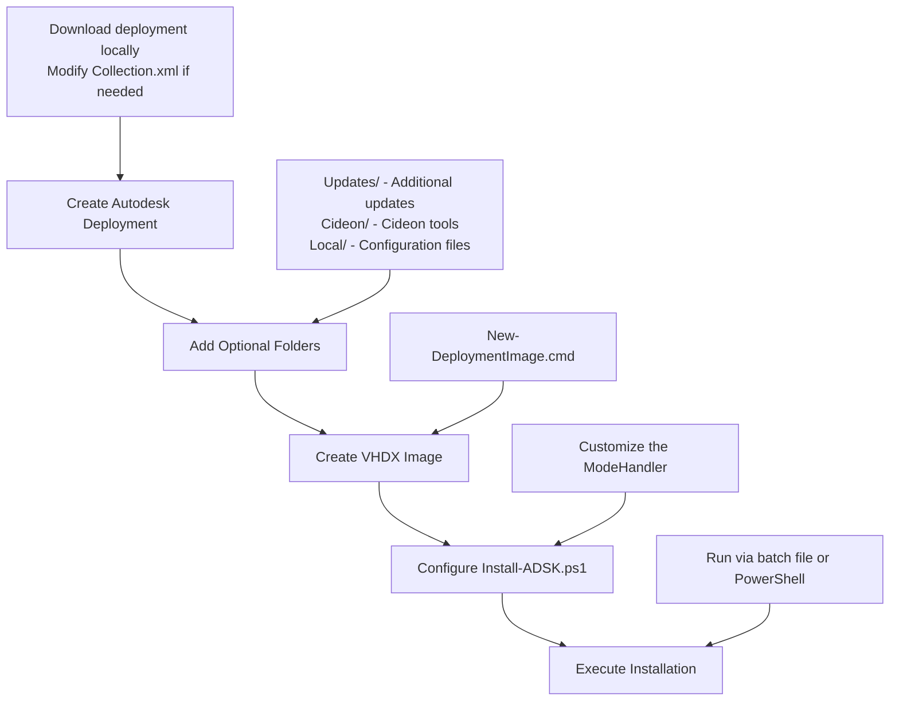

# Autodesk Deployments

[](https://github.com/CIDEON-EC/Autodesk-Deployments/actions/workflows/build-and-release.yml)

PowerShell tooling to install, update and uninstall Autodesk products (Inventor, AutoCAD, Vault) from a single image file (`.vhdx`, or `.wim` for older versions) in enterprise environments.

## Features

- One image per deployment: copy it locally, mount it, install, dismount, clean up.
- `.vhdx` images (required for Autodesk ODIS 2.24+, i.e. Autodesk 2027) and legacy `.wim` images.
- `New-DeploymentImage.ps1` creates the `.vhdx` from a folder (no Hyper-V module needed).
- Signed module: `Install-ADSK.ps1` loads `CIDEON.AutodeskDeployment.psm1` from a GitHub Release and verifies the Authenticode signature against a pinned thumbprint.
- You only write the mode-specific logic (`Install` / `Update` / `Uninstall`); the module handles logging, image handling and error handling.
- Dry run (`-WhatIf`), logging, optional cleanup (`-Purge`) and optional shutdown of running Autodesk applications (`-ForceQuit`).
- `Copy-Local.ps1` copies `Local/` content (`Users`, `ProgramData`) from the central deployment folder after the installation.

## Prerequisites

- Windows with PowerShell and administrator rights on the target machine.
- Access to GitHub Releases (the module is downloaded at runtime). If the download fails, a copy of the module in the script folder is used instead.
- An Autodesk deployment created with the Autodesk Installer (the `image/` folder with `Collection.xml`).
- Free disk space for the local image copy (`C:\Temp` by default, see `-LocalFolder`).

## Quick start

```powershell
# Go to the script location
cd \\SERVER\SHARE\ScriptLocation

# Install with logging, then delete the local image copy
.\Install-ADSK.ps1 -Image "PDC_2026" -Mode "Install" -Path "\\SERVER\SHARE\DEPLOYMENT" -Logging -Purge
```

For ready-made batch files see the `samples/` folder (`INSTALL.cmd`, `Copy-Local.cmd`).

## Workflow



### Step 1: Create the Autodesk deployment

1. Download your Autodesk deployment locally.
2. Copy `Collection.xml` and modify it for your needs (for example, remove AutoCAD to get an Inventor-only deployment).
3. Save it as a custom XML file, e.g. `Inventor_only.xml`.

### Step 2: Add optional folders

Create these folders next to `image/`. The names are fixed.

| Folder | Purpose | Example content |
|--------|---------|-----------------|
| `Updates/` | Product updates | `Update_Inventor_20XX.X.exe` |
| `Cideon/` | Cideon tools | `CIDEON.Inventor.Toolbox_x64.msi` |
| `Local/` | Configuration files | `ProgramData/`, `Users/` folders |

### Step 3: Create the image (.vhdx)

1. Drag the deployment folder onto `New-DeploymentImage.cmd`, or run `New-DeploymentImage.ps1 -Source <folder>`.
2. Confirm the UAC prompt. The script creates `<folder>.vhdx` next to the folder and needs about as much free disk space as the folder.

Name the folder descriptively (e.g. `PDC_2026`); the image gets the same name (`PDC_2026.vhdx`). Include all subfolders (`image/`, `Updates/`, `Cideon/`, `Local/`).

> **A `.wim` does not work with Autodesk ODIS 2.24+ (Autodesk 2027).** The installer refuses files inside a mounted WIM (exit code 453). Existing `.wim` images remain supported for older versions.

See [Create an image](#create-an-image-vhdx) for details.

### Step 4: Configure Install-ADSK.ps1

The solution consists of an installer and a module:

- `Install-ADSK.ps1`: parameters, module loader (GitHub + signature validation) and the `Invoke-DeploymentWorkflow` call with your mode-specific logic.
- `CIDEON.AutodeskDeployment.psm1`: all helper, deployment and orchestration functions. It is signed and loaded by the installer.

You edit only the `Code` region:

```powershell
#region Code
Invoke-DeploymentWorkflow -ModeHandler {
    switch ($Mode) {
        'Install'   { <# Your install steps #> }
        'Update'    { <# Your update steps #> }
        'Uninstall' { <# Your uninstall steps #> }
    }
}
#endregion
```

The module handles version validation, logging, image discovery (`.vhdx` or `.wim`), mount paths, error handling and the image dismount. All helper functions are documented in `CIDEON.AutodeskDeployment.psm1` (overview: [Function reference](#function-reference)).

### Step 5: Run the installation

```powershell
# PowerShell
.\Install-ADSK.ps1 -Image "PDC_2026" -Mode "Install" -Logging

# Batch file (see samples/)
INSTALL.cmd
```

## Folder structure

The structure is based on the default Autodesk deployments:

```
PDC_20XX/                                    # Autodesk deployment name
├── image/                                   # Default Autodesk deployment
│   ├── AMECH_PP_20XX_de-DE/
│   │   ├── setup.xml                        # Products to install
│   │   ├── setup_ext.xml                    # Updates and language packs
│   │   └── ...
│   ├── INVPROSA_20XX_de-DE/
│   ├── Collection.xml                       # Main deployment config
│   ├── Inventor_only.xml                    # Modified deployment config
│   └── ...
├── Updates/                                 # Additional updates
│   ├── Update_Inventor_20XX.X.exe
│   ├── Update_AutoCAD_20XX.X.exe
│   └── cer.msi
├── Cideon/                                  # Cideon tools
│   ├── CIDEON.VAULT.TOOLBOX.SETUP_XXXX.X.X.XXXXX.msi
│   ├── CIDEON.VAULT.TOOLBOX.SETUP.SERVICEPACK_XXXX.X.X.XXXXX.msi
│   ├── CIDEON.Inventor.Toolbox_x64_XXXX.X.X.XXXXX.msi
│   └── CDN_DataStandards_Setup_XXXX.X.X.XXXXX.msi
└── Local/                                   # Local configuration files
    ├── ProgramData/
    └── Users/
        ├── Public/                          # Public user folder
        │   └── Documents/CIDEON/LicenseFiles/20XX/
        └── USERNAME/                        # Renamed to the actual username
            └── AppData/Roaming/Autodesk/
```

| Folder | Purpose | Required |
|--------|---------|----------|
| `image/` | Default Autodesk deployment files | Yes |
| `Updates/` | Additional product updates to install | No |
| `Cideon/` | Cideon-specific tools and extensions | No |
| `Local/` | Local configuration files and user settings | No |

## Create an image (.vhdx)

Drag the deployment folder onto `New-DeploymentImage.cmd`. Tip: put a shortcut to it into `shell:sendto` (Win+R), then right-click the folder > *Send to* > *New-DeploymentImage*.

```powershell
New-DeploymentImage.ps1 -Source <folder> [-VhdxPath <file>] [-Force]
```

The script creates an expandable VHDX with `diskpart` (no Hyper-V module needed), formats it with NTFS and copies the folder content into it. The VHDX is about 1.6x the size of the WIM of the same folder because it is not compressed.

`-Image` takes the name without extension. If both `<name>.vhdx` and `<name>.wim` exist, the `.vhdx` is used. `-NoDownload` (mount from the server) only works for `.wim`, because a VHDX cannot be attached from a network share.

### How the image is mounted

| | `.vhdx` | `.wim` |
| --- | --- | --- |
| Local copy | `<LocalFolder>\<Image>.vhdx` (`C:\Temp` by default). Reused if size and modification time match the source | Same, `<LocalFolder>\<Image>.wim` |
| Mount | `Mount-DiskImage`; the data partition gets an automatically assigned **drive letter** (e.g. `E:\`) | `Mount-WindowsImage` into `<LocalFolder>\mount_<Image>` |
| Mount folder in `C:\Temp` | **None.** Only the `.vhdx` file itself is created there | `mount_<Image>` is created and deleted again |
| Paths during installation | `mountPath` and the config file paths (e.g. `E:\Image\Collection.xml`) are set to the drive root right after mounting | `<LocalFolder>\mount_<Image>\Image\Collection.xml` |
| Dismount | `Dismount-DiskImage`; the drive letter disappears. With `-Purge` the local `.vhdx` is deleted | `Dismount-WindowsImage -Discard`; the mount folder is deleted. With `-Purge` the local `.wim` is deleted |
| After an aborted run | A still attached `.vhdx` is dismounted before the next mount. An attachment does not survive a reboot, so no cleanup task is registered | The scheduled task `CleanupWIM` removes the stale mount point after a reboot |

Notes:

- While a `.vhdx` is mounted, an additional drive appears in Explorer. The letter is assigned automatically, so it does not collide with existing drives.
- The log shows the path of the local image file; the paths handed to `Installer.exe` are on the drive letter.
- The VHDX is mounted read-write. Changes the installer makes in the image (e.g. the rewritten `Collection.xml`) stay in the local copy.

## Install-ADSK.ps1 parameters

The parameters are also documented in the script itself (`Get-Help .\Install-ADSK.ps1 -Full`).

| Parameter | Type | Required | Default | Description |
|-----------|------|----------|---------|-------------|
| `Image` | String | Yes | - | Name of the image file without extension (`.vhdx` is used if it exists, otherwise `.wim`). Former name `-WIM` still works as alias |
| `Mode` | String | Yes | - | `Install`, `Update` or `Uninstall` |
| `Path` | String | No | Script location | Folder that contains the image file. Not needed if the image is in the same folder as the script |
| `LocalFolder` | String | No | `C:\Temp` | Local folder the image file is copied to. A `.wim` is additionally mounted into `mount_<Image>` there; a `.vhdx` uses a drive letter instead (see [How the image is mounted](#how-the-image-is-mounted)) |
| `Files` | String[] | No | `@("Collection")` | XML filenames without extension used for the installation. Before each install, `LoggingSettings` in the selected XML is set to `Logging=true` and `Path=<LocalFolder>\Install-ADSK-Deployment-<Image>.log` |
| `Version` | String | No | Extracted from the image name | Software version for Cideon tools and logging |
| `ModuleVersionPin` | String | No | Latest release | Pins the online module/certificate download to a release version (e.g. `1.2.0`) |
| `Logging` | Switch | No | `$false` | Writes a log file to the local folder |
| `Quiet` | Switch | No | `$false` | Suppresses progress output |
| `NoDownload` | Switch | No | `$false` | Mounts the image from the server instead of copying it locally (`.wim` only) |
| `Purge` | Switch | No | `$false` | Deletes the local image file when finished (cannot be combined with `-NoDownload`) |
| `ForceQuit` | Switch | No | `$false` | Quits running Autodesk applications (Inventor, AutoCAD, Vault) without confirmation. Use with caution |
| `SkipSignatureCheck` | Switch | No | `$false` | Skips the signature validation of the local fallback module. For development only |
| `WhatIf` | Switch | No | `$false` | Dry run: shows what would happen without making changes |
| `Confirm` | Switch | No | `$false` | Asks for confirmation before each action |

## Usage examples

```powershell
# Remote image, logging, delete the local copy afterwards
.\Install-ADSK.ps1 -Image "PDC_20XX" -Mode "Install" -Path "\\SERVER\SHARE\DEPLOYMENT" -Logging -Purge
```

```powershell
# Image next to the script (no -Path), mounted from the server (.wim only),
# Inventor_only.xml instead of the default Collection.xml
.\Install-ADSK.ps1 -Image "PDC_20XX" -Mode "Install" -Logging -NoDownload -Files "Inventor_only"
```

```powershell
# Dry run
.\Install-ADSK.ps1 -Image "PDC_20XX" -Mode "Install" -Path "\\SERVER\SHARE\DEPLOYMENT" -WhatIf
```

```powershell
# Pin the module download to release 1.2.0 (default is the latest release)
.\Install-ADSK.ps1 -Image "PDC_20XX" -Mode "Install" -ModuleVersionPin "1.2.0"
```

```powershell
# Uninstall / Update
.\Install-ADSK.ps1 -Image "PDC_20XX" -Mode "Uninstall" -Path "\\SERVER\SHARE\DEPLOYMENT" -Logging
.\Install-ADSK.ps1 -Image "PDC_20XX" -Mode "Update" -Path "\\SERVER\SHARE\DEPLOYMENT" -Logging
```

Tips:

- To change the deployment or add files, create a new image from the deployment folder.
- Always use `-Logging` for troubleshooting.

## Copy-Local.ps1

`Copy-Local.ps1` copies subfolders of `Local/` from the central deployment folder to the local machine after the installation (`Users` by default; pass `-Folder "Users","ProgramData"` for both). It uses the same signed module loader as `Install-ADSK.ps1`, including the optional `-ModuleVersionPin`.

```powershell
# Default folder: "Users"
.\Copy-Local.ps1 -Path "\\vaultsrv\CIDEON\_DPL"

# Both folders
.\Copy-Local.ps1 -Path "\\vaultsrv\CIDEON\_DPL" -Folder "Users","ProgramData"

# Only "Users", module pinned to release 1.2.0
.\Copy-Local.ps1 -Path "\\vaultsrv\CIDEON\_DPL" -Folder "Users" -ModuleVersionPin "1.2.0"
```

Batch file (`samples/Copy-Local.cmd`):

```cmd
@ECHO OFF
set skript=\\vaultsrv\CIDEON\_DPL\Copy-Local.ps1

powershell.exe -ExecutionPolicy Bypass -File %skript% -Path "\\vaultsrv\CIDEON\_DPL" -Folder "Users"
```

## Module and certificate

| File | Purpose |
|------|---------|
| `Install-ADSK.ps1` | Installer |
| `CIDEON.AutodeskDeployment.psm1` | Signed module |
| `CIDEON-CodeSigning.cer` | Public certificate |
| `Certificate.md` | Certificate guide |

The installer and `Copy-Local.ps1` load the module and certificate from GitHub Release assets (default: latest release, optional: `-ModuleVersionPin`). They then:

1. Validate the downloaded certificate against a pinned thumbprint allowlist.
2. Validate the module signature against the same allowlist.
3. Fall back to the local module in the script directory if remote loading fails.

Current pinned code-signing thumbprint: `53D03841EC43C1C545F56919F9A6AEF0C7D2E783`

If the code-signing certificate is rotated, update the allowlist (`$TrustedCertificateThumbprints`) in both `Install-ADSK.ps1` and `Copy-Local.ps1` before trusting the new release certificate.

## Function reference

All functions live in `CIDEON.AutodeskDeployment.psm1`.

| Function | Description | Required parameters | Optional parameters |
|----------|-------------|---------------------|---------------------|
| `Set-InstallContext` | Stores deployment context values (Version, LogFile, imageFile, mountPath, etc.) as global variables so all module functions share state | `Context` | - |
| `Invoke-DeploymentWorkflow` | Orchestrates the full image deployment lifecycle (version validation, logging, image discovery, mount/dismount, error handling) and invokes a caller-supplied ScriptBlock for the mode-specific logic | `ModeHandler` | - |
| `Write-InstallLog` | Writes log entries to file (if logging is enabled) | `text` | `Info`, `Fail` |
| `Write-InstallProgress` | Writes compact progress status to the host; suppressed when `-Quiet` is active | `Text` | `Fail` |
| `Update-WIMInspectionCache` | Inspects and caches WIM folder/file metadata for later use | `MountedPath` | - |
| `Get-CachedFiles` | Returns cached file-like entries for WhatIf scenarios | `Path`, `OperationText` | `CachedFiles` |
| `Install-Update` | Installs updates from the Updates subfolder | - | `Path` |
| `Install-AutodeskDeployment` | Installs the Autodesk deployment from the image subfolder | - | `Path` |
| `Uninstall-AutodeskDeployment` | Uninstalls the Autodesk deployment | - | `Path`, `Product` |
| `Set-AutodeskDeployment` | Configures Autodesk deployment settings | - | - |
| `Install-CideonTool` | Installs Cideon tools from the Cideon subfolder | - | Various Cideon switches |
| `Disable-VaultExtension` | Moves Vault extensions to disable them | - | `Filter`, `Version`, `Keep` |
| `Get-RealUserName` | Gets the actual username when running as admin | - | - |
| `Get-UserSID` | Gets the user Security Identifier (SID) | - | `UserName`, `DomainUser`, `LocalUser` |
| `Set-InventorProjectFile` | Sets the Inventor project file path in the registry | - | `Version`, `File` |
| `Remove-UserSystemVariable` | Removes user environment variables | - | - |
| `Copy-Local` | Copies local configuration files | - | `Path`, `SourceFolder`, `TargetFolder` |
| `Uninstall-Program` | Uninstalls programs by display name or publisher | `DisplayName` or `Publisher` | `FilterOperator` |
| `Get-InstalledProgram` | Gets the list of installed programs | - | `DisplayName`, `Publisher`, `FilterOperator` |
| `Set-CIDEONLanguageVariable` | Sets Cideon language environment variables | - | - |
| `Set-CIDEONVariable` | Sets Cideon environment variables | - | `Version` |
| `Rename-RegistryInstallationPath` | Renames registry installation paths | - | - |
| `Copy-DeploymentImage` | Copies the image file (.vhdx or .wim) from the network share to the local machine. Former name `Copy-WIM` still works | `File` | `Folder` |
| `Mount-DeploymentImage` | Mounts the image (.wim with `Mount-WindowsImage` into the specified folder, .vhdx with `Mount-DiskImage` to a drive letter; `mountPath` and the config paths then point to the drive root). In WhatIf mode it performs a read-only inspection mount. Former name `Mount-WIM` still works | `File` | `Path` |
| `Dismount-DeploymentImage` | Dismounts the image (.wim or .vhdx) and removes the mount folder (.wim only). Former name `Dismount-WIM` still works | `File` | `purge`, `all` |
| `Register-WIMDismountTask` | Registers the scheduled task that dismounts a WIM | - | - |
| `Set-AutodeskUpdate` | Configures Autodesk update settings | One of `Enable`, `ShowOnly`, `Disable` | - |
| `Get-AppLogError` | Retrieves application log errors | - | - |
| `Get-AutodeskProcesses` | Returns all running Autodesk processes (Inventor, AutoCAD, Vault, JobProcessor) | - | - |
| `Test-AutodeskProcessesRunning` | Returns `$true` if at least one Autodesk process is running | - | - |
| `Stop-AutodeskProcess` | Stops all running Autodesk processes; used by `-ForceQuit` | - | `Force` |

By category:

- **Orchestration:** `Set-InstallContext`, `Invoke-DeploymentWorkflow`
- **Installation and deployment:** `Install-AutodeskDeployment`, `Uninstall-AutodeskDeployment`, `Set-AutodeskDeployment`, `Install-Update`, `Install-CideonTool`
- **Image management:** `Copy-DeploymentImage`, `Mount-DeploymentImage`, `Dismount-DeploymentImage`, `Register-WIMDismountTask` (the old `*-WIM` names are aliases)
- **Image inspection and simulation:** `Update-WIMInspectionCache`, `Get-CachedFiles`
- **System configuration:** `Set-InventorProjectFile`, `Set-AutodeskUpdate`, `Disable-VaultExtension`, `Set-CIDEONVariable`, `Set-CIDEONLanguageVariable`
- **User and system information:** `Get-RealUserName`, `Get-UserSID`, `Get-InstalledProgram`, `Get-AppLogError`
- **File and registry operations:** `Copy-Local`, `Remove-UserSystemVariable`, `Rename-RegistryInstallationPath`
- **Process management:** `Get-AutodeskProcesses`, `Test-AutodeskProcessesRunning`, `Stop-AutodeskProcess`
- **Utilities:** `Write-InstallLog`, `Write-InstallProgress`, `Uninstall-Program`

## Development

Tests use Pester 5 (the script installs it if missing); linting uses PSScriptAnalyzer.

```powershell
# Run all tests
.\.scripts\Invoke-PesterTests.ps1

# Enable the pre-commit hook (PSScriptAnalyzer + Pester)
.\.scripts\Enable-GitHooks.ps1
```

See `TEST-MATRIX.md` for test coverage and [CHANGELOG.md](CHANGELOG.md) for changes.

### Release

A release is triggered by changing the `VERSION` file on `main`; CI creates the tag, signs the module and builds the release. See `.github/workflows/README.md`.

## License

Licensed under the [PolyForm Internal Use License 1.0.0](LICENSE.md). Required notice: Copyright (c) 2026 CIDEON Software & Services GmbH & Co. KG
