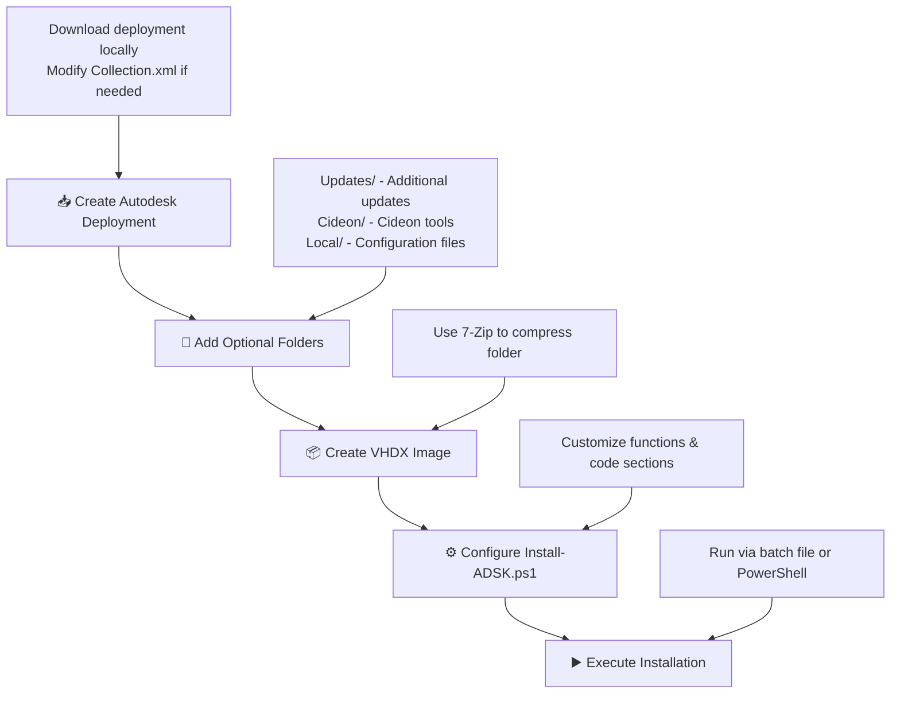

# Install Autodesk Deployments with a VHDX image (or WIM)

## 🚀 Workflow

### 📋 **Step-by-Step Guide**



#### **🎯 Step 1: Create Autodesk Deployment**
- 📥 **Download** your Autodesk deployment locally
- 📝 **Copy** the `Collection.xml` and modify it for your needs
  - *Example: Remove AutoCAD to create an Inventor-only deployment*
- 💾 **Save** as custom XML file (e.g., `Inventor_only.xml`)

#### **📁 Step 2: Add Optional Folders** *(Optional)*
Create these **hardcoded folder names** for additional content:

| Folder | Purpose | Content Example |
|--------|---------|----------------|
| 📁 **Updates/** | Product updates | `Update_Inventor_20XX.X.exe` |
| 📁 **Cideon/** | Cideon tools | `CIDEON.Inventor.Toolbox_x64.msi` |
| 📁 **Local/** | Config files | `ProgramData/`, `Users/` folders |

#### **📦 Step 3: Create the image (.vhdx)**
- 🖱️ **Drag the deployment folder onto `New-DeploymentImage.cmd`** (or run `New-DeploymentImage.ps1 -Source <folder>`). It creates `<folder>.vhdx` next to the folder, asks for administrator rights (UAC) and needs about as much free disk space as the folder
- 📁 **Include** all subfolders (`image/`, `Updates/`, `Cideon/`, `Local/`)
- 💾 **Name** the folder descriptively (e.g., `PDC_2026`), the image gets the same name (`PDC_2026.vhdx`)
- ⚠️ **A .wim does not work for Autodesk ODIS 2.24+ (Autodesk 2027)**: the installer refuses files inside a mounted WIM (exit code 453). Existing `.wim` images are still supported for older versions

#### **⚙️ Step 4: Configure Install-ADSK.ps1**
The solution now consists of **installer + module**:

```powershell
# Install-ADSK.ps1
# - Parameters
# - Module loader (GitHub + signature validation)
# - Invoke-DeploymentWorkflow with your mode-specific logic

# CIDEON.AutodeskDeployment.psm1
# - All helper, deployment and orchestration functions
# - Signed and loaded by installer

#region Code
Invoke-DeploymentWorkflow -ModeHandler {
    switch ($Mode) {
        'Install'   { <# 🎯 Your install steps #> }
        'Update'    { <# 🎯 Your update steps #> }
        'Uninstall' { <# 🎯 Your uninstall steps #> }
    }
}
#endregion
```

> 💡 **Tip:** Function implementations are now located in `CIDEON.AutodeskDeployment.psm1`.

#### **▶️ Step 5: Execute Installation**
Choose your preferred method:

```powershell
# 🎯 Direct PowerShell execution
.\Install-ADSK.ps1 -Image "PDC_2026" -Mode "Install" -Logging

# 📦 Via batch file (see samples/ folder)
Install-Example.bat
```

---

### 🎯 **Quick Start Example**

```powershell
# 📍 Navigate to script location
cd \\SERVER\SHARE\ScriptLocation

# 🚀 Run installation with logging and cleanup
.\Install-ADSK.ps1 -Image "PDC_2026" -Mode "Install" -Path "\\SERVER\SHARE\DEPLOYMENT" -Logging -Purge
```

### ✨ **Pro Tips**

- 🔄 **Version Updates:** Just create a new image for deployment changes
- 📁 **Batch Files:** Check the `samples/` folder for common scenarios
- 🛠️ **Local Copies:** Use `Copy-Local.ps1` as a thin module-backed wrapper for post-installation file copying
- 📝 **Logging:** Always use `-Logging` for troubleshooting

## Sample folder structure
The folder structure is based on the default Autodesk deployments. This could look like this:

```
📁 PDC_20XX                                    # Autodesk deployment name
├── 📁 image/                                  # Default Autodesk deployment
│   ├── 📁 AMECH_PP_20XX_de-DE/
│   │   ├── 📄 setup.xml                       # Products to install
│   │   ├── 📄 setup_ext.xml                   # Updates and language packs
│   │   └── 📄 ...
│   ├── 📁 INVPROSA_20XX_de-DE/
│   ├── 📄 Collection.xml                      # Main deployment config
│   ├── 📄 Inventor_only.xml                   # Modified deployment config
│   └── 📄 ...
│
├── 📁 Updates/                                # Additional updates
│   ├── 🔧 Update_Inventor_20XX.X.exe
│   ├── 🔧 Update_AutoCAD_20XX.X.exe
│   └── 🔧 cer.msi
│
├── 📁 Cideon/                                 # Cideon Tools
│   ├── 📦 CIDEON.VAULT.TOOLBOX.SETUP_XXXX.X.X.XXXXX.msi
│   ├── 📦 CIDEON.VAULT.TOOLBOX.SETUP.SERVICEPACK_XXXX.X.X.XXXXX.msi
│   ├── 📦 CIDEON.Inventor.Toolbox_x64_XXXX.X.X.XXXXX.msi
│   └── 📦 CDN_DataStandards_Setup_XXXX.X.X.XXXXX.msi
│
├── 📁 Local/                                  # Local configuration files
│   ├── 📁 ProgramData/
│   └── 📁 Users/
│       ├── 📁 Public/                         # Public user folder
│       │   └── 📁 Documents/
│       │       └── 📁 CIDEON/
│       │           └── 📁 LicenseFiles/
│       │               └── 📁 20XX/
│       └── 📁 USERNAME/                       # Local user folder (renamed to actual username)
│           └── 📁 AppData/
│               └── 📁 Roaming/
│                   └── 📁 Autodesk/
│
└── ⚡ Install-ADSK.ps1                        # Main installation script
```

### 📋 Folder Descriptions

| Folder | Purpose | Required |
|--------|---------|----------|
| **📁 image/** | Contains the default Autodesk deployment files | ✅ |
| **📁 Updates/** | Additional product updates to install | ❌ |
| **📁 Cideon/** | Cideon-specific tools and extensions | ❌ |
| **📁 Local/** | Local configuration files and user settings | ❌ |
## Create an image (.vhdx)
Drag the deployment folder onto `New-DeploymentImage.cmd`. Tip: put a shortcut to it into `shell:sendto` (Win+R), then right-click the folder > *Send to* > *New-DeploymentImage*.

The script (`New-DeploymentImage.ps1 -Source <folder> [-VhdxPath <file>] [-Force]`) creates an expandable VHDX with `diskpart` (no Hyper-V module needed), formats it with NTFS and copies the folder content into it. The VHDX is about 1.6x the size of the WIM of the same folder, because it is not compressed. Install-ADSK.ps1 attaches it with `Mount-DiskImage` and uses the automatically assigned drive letter (no mount folder; a WIM still uses the mount folder).

`-Image` takes the name without extension; if both `<name>.vhdx` and `<name>.wim` exist, the `.vhdx` is used. `-NoDownload` (mount from the server) only works for `.wim`, because a VHDX cannot be attached from a network share.

### How the image is mounted

| | `.vhdx` | `.wim` |
| --- | --- | --- |
| Local copy | `<LocalFolder>\<Image>.vhdx` (`C:\Temp` by default). Reused if size and modification time match the source | same, `<LocalFolder>\<Image>.wim` |
| Mount | Attached with `Mount-DiskImage`; the data partition gets an automatically assigned **drive letter** (e.g. `E:\`) | Mounted with `Mount-WindowsImage` into the folder `<LocalFolder>\mount_<Image>` |
| Mount folder / link in `C:\Temp` | **None.** Nothing but the `.vhdx` file itself is created there | `mount_<Image>` is created and deleted again |
| Paths during installation | `mountPath` and the config file paths (e.g. `E:\Image\Collection.xml`) are set to the drive root right after mounting | `<LocalFolder>\mount_<Image>\Image\Collection.xml` |
| Dismount | `Dismount-DiskImage`; the drive letter disappears. With `-Purge` the local `.vhdx` is deleted | `Dismount-WindowsImage -Discard`, the mount folder is deleted. With `-Purge` the local `.wim` is deleted |
| After an aborted run | A `.vhdx` that is still attached is dismounted before the next mount. An attachment does not survive a reboot, so no cleanup task is registered | The scheduled task `CleanupWIM` removes the stale mount point after a reboot |

Notes:
- While a `.vhdx` is mounted, an additional drive appears in Explorer. The letter is assigned automatically, so it does not collide with existing drives.
- The log shows the path of the local image file; the paths handed to `Installer.exe` are on the drive letter.
- The VHDX is mounted read-write. Changes the installer makes in the image (e.g. the rewritten `Collection.xml`) stay in the local copy.

## Change the Install-ADSK.ps1 for your needs
The script has two sections:
1. **Module Loader** — Loads `CIDEON.AutodeskDeployment.psm1` from GitHub and validates the Authenticode signature.
2. **Code** — Calls `Invoke-DeploymentWorkflow -ModeHandler { … }`. The module handles version validation, logging, image discovery (.vhdx or .wim), mount paths, error handling and image dismount. You only supply the mode-specific logic (`Install` / `Update` / `Uninstall`) inside the `switch ($Mode)` block.

All helper functions are documented in `CIDEON.AutodeskDeployment.psm1`.

## Module + Certificate

- Installer: `Install-ADSK.ps1`
- Module: `CIDEON.AutodeskDeployment.psm1`
- Public certificate: `CIDEON-CodeSigning.cer`
- Certificate guide: `Certificate.md`

The installer (and `Copy-Local.ps1`) loads the module from GitHub Release assets, validates the downloaded certificate against a pinned thumbprint allowlist, validates the module signature against that same signer allowlist, and falls back to the local module in the script directory if remote loading fails.

Current pinned code-signing thumbprint:
- `53D03841EC43C1C545F56919F9A6AEF0C7D2E783`

If the code-signing certificate is rotated, update the pinned thumbprint allowlist (`$TrustedCertificateThumbprints`) in both `Install-ADSK.ps1` and `Copy-Local.ps1` before trusting the new release certificate.

The installer resolves the module and certificate from GitHub Release assets:
- default: latest release
- optional: pinned release version via `-ModuleVersionPin`


## FAQ
### What if I need to change the Autodesk deployment or change/add files?
The fastest way is just to create a new image from the deployment folder (drag it onto `New-DeploymentImage.cmd`)
<br><br>

### How to call the powershells and with wich parameters?
You can find batch files in the subfolder "samples" for all the basic scenarios.
<br><br>

### How can I copy file to the ProgramData folder or to the Users folder after installation?
Ha, I got you!
For this you can find the Copy-Local.ps1. It now uses the same signed module loader as Install-ADSK.ps1, including the optional pinned release version.

This allows you to copy (by default the ProgramData and Users Folder) from the central stored deployment folders.

Optional module pin example:

```powershell
.\Copy-Local.ps1 -Path "\\vaultsrv\CIDEON\_DPL" -Folder "Users" -ModuleVersionPin "1.2.0"
```

<h5 a><strong><code>Copy-Local.bat</code></strong></h5>

```cmd
@ECHO OFF
skript="\\vaultsrv\CIDEON\_DPL\Copy-Local.ps1"

powershell.exe -ExecutionPolicy Bypass %skript% -Path "\\vaultsrv\CIDEON\_DPL" -Folder "Users"

REM Default folders are "Users" and "ProgramData"
REM powershell.exe -ExecutionPolicy Bypass %skript% -Path "\\vaultsrv\CIDEON\_DPL"
```
<br><br><br>

### What are the parameters for the Install-ADSK.ps1?
You can find this in the file itself, but here is an overview.

| Parameter | Type | Required | Default | Description |
|-----------|------|----------|---------|-------------|
| **Image** | String | ✅ | - | Name of the image file without extension (`.vhdx` is used if it exists, otherwise `.wim`). Former name: `-WIM` (still works as alias) |
| **Mode** | String | ✅ | - | Mode to execute: `Install`, `Uninstall`, `Update` |
| **Path** | String | ❌ | Script location | Path to the image file. Not needed if the image is in same folder as script |
| **LocalFolder** | String | ❌ | `C:\Temp` | Local folder where the image file is copied to. A `.wim` is additionally mounted into `mount_<Image>` there, a `.vhdx` uses a drive letter instead (see "How the image is mounted") |
| **Files** | String Array | ❌ | `@("Collection")` | XML filenames WITHOUT extension for installation. Before each install, `LoggingSettings` in the selected XML is enforced to `Logging=true` and `Path=<LocalFolder>\\Install-ADSK-Deployment-<Image>.log` |
| **Version** | String | ❌ | Auto-extracted | Software version for Cideon tools and logging |
| **ModuleVersionPin** | String | ❌ | Latest Release | Pins online module/certificate download to a specific release version (e.g. `1.2.0`) |
| **Logging** | Switch | ❌ | `$false` | Enable log file creation in local folder |
| **NoDownload** | Switch | ❌ | `$false` | Mount the image from the server instead of copying locally (`.wim` only) |
| **Purge** | Switch | ❌ | `$false` | Delete the local image file after completion (cannot be combined with `-NoDownload`) |
| **WhatIf** | Switch | ❌ | `$false` | Dry run mode: shows what would happen without making changes |
| **Confirm** | Switch | ❌ | `$false` | Prompts for confirmation before executing actions |
| **ForceQuit** | Switch | ❌ | `$false` | Quits running Autodesk Applications (Inventor, AutoCAD, Vault) |
<br><br><br>

### How can I call the Install-ADSK?
```powershell
# Go to the script location
cd \\SERVER\SHARE\ScriptLocation
# Call Installation
## Path is needed because the deployment is stored on another location
## Logging enabled
## Purge enabled (deletes the image locally)
.\Install-ADSK.ps1 -Image "PDC_20XX" -Mode "Install" -Path "\\SERVER\SHARE\DEPLOYMENT" -Logging -Purge
```
```powershell
# Call Installation
## Path is not needed, because Install-ADSK.ps1 is parallel to the deployment folder
## Logging enabled
## The image will not be downloaded, it will be mounted from the server directly (slower installation, .wim only)
### Instead of default Collection.xml, the Inventor_only.xml is used
.\Install-ADSK.ps1 -Image "PDC_20XX" -Mode "Install" -Logging -NoDownload -Files "Inventor_only"
```
```powershell
# Dry run (preview all actions)
.\Install-ADSK.ps1 -Image "PDC_20XX" -Mode "Install" -Path "\\SERVER\SHARE\DEPLOYMENT" -WhatIf
```
```powershell
# Pin online module download to release 1.2.0 (default is latest release)
.\Install-ADSK.ps1 -Image "PDC_20XX" -Mode "Install" -ModuleVersionPin "1.2.0"
```
```powershell
# Uninstall mode
.\Install-ADSK.ps1 -Image "PDC_20XX" -Mode "Uninstall" -Path "\\SERVER\SHARE\DEPLOYMENT" -Logging
```
```powershell
# Update mode
.\Install-ADSK.ps1 -Image "PDC_20XX" -Mode "Update" -Path "\\SERVER\SHARE\DEPLOYMENT" -Logging
```

## Function Reference

### Overview of all Functions in Install-ADSK.ps1

| Function | Description | Required Parameters | Optional Parameters |
|----------|-------------|-------------------|-------------------|
| **Set-InstallContext** | Stores deployment context values (Version, LogFile, imageFile, mountPath, etc.) as global variables so all module functions share state | `Context` | - |
| **Invoke-DeploymentWorkflow** | Orchestrates the full image deployment lifecycle (version validation, logging, image discovery, mount/dismount, error handling) and invokes a caller-supplied ScriptBlock for mode-specific logic | `ModeHandler` | - |
| **Write-InstallLog** | Writes log entries to file (if logging enabled) | `text` | `Info`, `Fail` |
| **Write-InstallProgress** | Writes compact progress status to the host; suppressed when `-Quiet` is active | `Text` | `Fail` |
| **Update-WIMInspectionCache** | Inspects and caches WIM folder/file metadata for later use | `MountedPath` | - |
| **Get-CachedFiles** | Returns cached file-like entries for WhatIf scenarios | `Path`, `OperationText` | `CachedFiles` |
| **Install-Update** | Installs updates from Updates subfolder | - | `Path` |
| **Install-AutodeskDeployment** | Installs Autodesk deployment from Image subfolder | - | `Path` |
| **Uninstall-AutodeskDeployment** | Uninstalls Autodesk deployment | - | `Path`, `Product` |
| **Set-AutodeskDeployment** | Configures Autodesk deployment settings | - | - |
| **Install-CideonTool** | Installs Cideon tools from Cideon subfolder | - | Various Cideon switches |
| **Disable-VaultExtension** | Moves Vault extensions to disable them | - | `Filter`, `Version`, `Keep` |
| **Get-RealUserName** | Gets actual username when running as admin | - | - |
| **Get-UserSID** | Gets user Security Identifier (SID) | - | `UserName`, `DomainUser`, `LocalUser` |
| **Set-InventorProjectFile** | Sets Inventor project file path in registry | - | `Version`, `File` |
| **Remove-UserSystemVariable** | Removes user system environment variables | - | - |
| **Copy-Local** | Copies local configuration files | - | `Path`, `SourceFolder`, `TargetFolder` |
| **Uninstall-Program** | Uninstalls programs by display name/publisher | `DisplayName` OR `Publisher` | `FilterOperator` |
| **Get-InstalledProgram** | Gets list of installed programs | - | `DisplayName`, `Publisher`, `FilterOperator` |
| **Set-CIDEONLanguageVariable** | Sets Cideon language environment variables | - | - |
| **Set-CIDEONVariable** | Sets Cideon environment variables | - | `Version` |
| **Rename-RegistryInstallationPath** | Renames registry installation paths | - | - |
| **Copy-DeploymentImage** | Copies the image file (.vhdx or .wim) from network share to local machine. Former name `Copy-WIM` still works | `File` | `Folder` |
| **Mount-DeploymentImage** | Mounts the image (.wim with `Mount-WindowsImage` to the specified folder, .vhdx with `Mount-DiskImage` to a drive letter; `mountPath` and the config paths are then pointed to the drive root); in WhatIf mode performs read-only inspection mount. Former name `Mount-WIM` still works | `File` | `Path` |
| **Dismount-DeploymentImage** | Dismounts the image (.wim or .vhdx) and removes the mount folder (.wim only). Former name `Dismount-WIM` still works | `File` | `purge`, `all` |
| **Register-WIMDismountTask** | Registers scheduled task for WIM dismount | - | - |
| **Set-AutodeskUpdate** | Configures Autodesk update settings | One of: `Enable`, `ShowOnly`, `Disable` | - |
| **Get-AppLogError** | Retrieves application log errors | - | - |
| **Get-AutodeskProcesses** | Returns all running Autodesk processes (Inventor, AutoCAD, Vault, JobProcessor) | - | - |
| **Test-AutodeskProcessesRunning** | Checks whether any Autodesk processes are currently running; returns `$true` if at least one is found | - | - |
| **Stop-AutodeskProcess** | Stops all running Autodesk processes; used by `-ForceQuit` in Install-ADSK.ps1 | - | `Force` |

### Function Categories

#### **Orchestration**
- `Set-InstallContext`, `Invoke-DeploymentWorkflow`

#### **Installation & Deployment**
- `Install-AutodeskDeployment`, `Uninstall-AutodeskDeployment`, `Set-AutodeskDeployment`
- `Install-Update`, `Install-CideonTool`

#### **Image Management**
- `Copy-DeploymentImage`, `Mount-DeploymentImage`, `Dismount-DeploymentImage`, `Register-WIMDismountTask` (old `*-WIM` names are aliases)

#### **Image Inspection & Simulation**
- `Update-WIMInspectionCache`, `Get-CachedFiles`

#### **System Configuration**
- `Set-InventorProjectFile`, `Set-AutodeskUpdate`, `Disable-VaultExtension`
- `Set-CIDEONVariable`, `Set-CIDEONLanguageVariable`

#### **User & System Information**
- `Get-RealUserName`, `Get-UserSID`, `Get-InstalledProgram`, `Get-AppLogError`

#### **File & Registry Operations**
- `Copy-Local`, `Remove-UserSystemVariable`, `Rename-RegistryInstallationPath`

#### **Process Management**
- `Get-AutodeskProcesses`, `Test-AutodeskProcessesRunning`, `Stop-AutodeskProcess`

#### **Utilities**
- `Write-InstallLog`, `Write-InstallProgress`, `Uninstall-Program`
